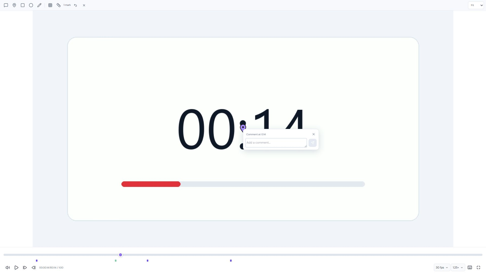

# Player audit and production release — 2026-10-15

The updated review player is deployed to https://edicut.com. Cloudflare Worker `edicut-web`, version `3ff16e73-3c8f-4989-83a0-c7799d73a075`, is serving 100% of traffic. Deployment ID: `081b5f22-ce2c-4a22-92d2-9fdacac8cb84`. Previous version: `d47f1bf7-9d06-4151-a284-3da173a261c0`.

## Changes

- `apps/web/app/components/ReviewPlayer.tsx`: volume first and fullscreen last in visual and keyboard order; inward fullscreen exit icon; compact custom FPS/speed menus; accurate action-time timestamps; loading/buffering status; cached metadata hydration fix; serialized preview seeks.
- `apps/web/app/components/ReviewPlaybackMenu.tsx`: new keyboard-operated combobox/listbox, selected checks, neutral focus styling, outside/escape dismissal and active option scrolling. Menus remain inside the fullscreen player. FPS choices are capped at the detected source rate.
- `apps/web/app/components/ReviewCanvas.tsx`: replaces selection/arrow toolbar controls with a comment tool; click a point to open a slim floating composer with send at the right. Existing saved arrows still render. Keyboard placement, IME-safe Enter-to-send, Shift+Enter newline, edge clamping and animation-frame-coalesced drawing previews. A follow-up audit fixed Escape dismissing the floating composer when the user only intended to close a dropdown: the native document listener now respects consumed events and focused dropdowns, including when it runs before delegated React handlers.
- `apps/web/app/components/ProjectReviewWorkspace.tsx`: keeps playback time in a ref to avoid re-rendering the entire feedback workspace each video tick; optimistic text feedback/replies with pending state, duplicate-send protection, rollback and deduplication.
- `apps/web/app/components/ReviewFeedback.tsx`: memoized reply grouping; accurate timestamp capture; pending comment status; double-submit guard; safe draft retention and stable retry IDs; dirty edit protection.
- `apps/web/app/components/ProjectReviewPage.tsx`: confirmed comment saves release the send button before background loader revalidation finishes.
- `apps/web/app/lib/project-review.ts`: client-only pending comment flag.
- `apps/web/workers/security-headers.ts` and its test: failed asset responses override inherited immutable cache headers with `no-store`. The live browser reproduced a cached script 404 with a one-year lifetime; bypassing its cache restored hydration. Successful fingerprinted assets retain long-term caching, and 304 responses retain conditional caching. Regression tests reproduced the error policy before the fix.
- `apps/web/app/styles/review-proofing.css`: compact menus and floating composer; responsive transport layout.
- `apps/web/app/components/ReviewInteractions.test.tsx`, `ReviewPlayer.test.tsx`, `ProjectReviewWorkspace.test.tsx`, `ReviewCanvas.interactions.test.tsx`: interaction and regression coverage. The new Escape regression reproduced the bug before the correction, then passed afterward. Root `package.json`/`pnpm-lock.yaml` add happy-dom as a development-only test dependency.
- `docs/deployment.md`: current production version recorded. Unrelated existing workspace changes were preserved.

## Verification

| Check | Result |
| --- | --- |
| `pnpm exec vitest run` | 1,076 passed, 21 skipped; 114 passed test files, 2 skipped |
| Focused player/feedback/canvas/parser/route tests | 32 passed |
| `pnpm --filter @edicut/web typecheck` | Passed |
| `pnpm typecheck` | Passed across the configured workspace packages |
| `pnpm --filter @edicut/web build` and `pnpm build` | Passed; public prerendered routes preserved |
| Prettier checks for custom menu, canvas and new interaction test | Passed |
| `git diff --check` | Passed; only existing Windows line-ending conversion warnings |
| Wrangler account/config/branch inspection | Intended account `f2c46bb116722bcb7dc4be44e500154b`, production profile, `main`, edicut.com routes, existing Hyperdrive and D1 bindings |
| `wrangler deploy --profile edicut-production --dry-run` | Passed |
| `pnpm --filter @edicut/web run deploy` | Succeeded; expected apex/www routes; 64 ms Worker startup reported by Wrangler |
| Deployment listing | New version at 100% |
| `node artifacts/verify-player-release-2026-10-15.mjs` | Homepage, sign-in and health HTTP 200; health database connected; anonymous project request redirected to sign-in; player JS/CSS and FPS parser SHA-256 match the local release build |
| Failed asset live regression | Deliberately missing script returns HTTP 404 with `Cache-Control: no-store`; successful release scripts retain immutable caching |

Local browser checks covered playback progression, mute, frame controls, custom menus/keyboard interaction, fullscreen entry/exit, a 390 px mobile viewport without horizontal overflow, and floating comment placement. The existing authenticated live browser session additionally verified native playback progression (readyState 4), source FPS options 23.976/24/25/29.97/30, speed selection, fullscreen and floating composer. Test drafts were cleared; no synthetic production comments were submitted or deleted.

Final release verification used normal browser caching. The current player script loaded with HTTP 200, the page hydrated, and closing the FPS dropdown with Escape kept the floating composer open. Entering an unsent note enabled the right-side send button and synchronized the sidebar draft. The note, annotation and timestamp were cleared afterward. The final live page reported no captured console errors. Temporary cache bypass and diagnostic subscriptions were restored/disabled before completion.

Automated component tests confirm an immediate pending comment, a single request on double submit, pending state clearing after persistence acknowledgement, rollback with draft retention on failure, and stable idempotency keys for retry. Server authorization and idempotent save protections remain in place.

## Limits and follow-up

The 21 skipped tests require isolated database integration configuration. A fresh production comment write was not exercised; the save interaction was verified with deferred-success/failure component tests and existing route tests. Run the isolated database integration suite when that environment is available.

Optimistic display is immediate; durable saving still requires server acknowledgement. Playback performance also depends on the source codec, device and network. Variable-frame-rate metadata can be estimated, and embedded YouTube sources do not expose inspectable source FPS; the UI disables unsupported frame stepping rather than inventing a rate.

## Evidence

- [Deployment output](player-deployment-2026-10-15.log)
- [Live HTTP and asset verification](player-live-verification-2026-10-15.json)
- [Test output](player-release-tests-2026-10-15.log)
- [Workspace type checks](player-workspace-typecheck-2026-10-15.log)
- [Workspace build](player-workspace-build-2026-10-15.log)
- [Live fullscreen composer screenshot](player-live-fullscreen-2026-10-15.jpg)
- [Local mobile screenshot](player-release-mobile-2026-10-15.jpg)
- [Live player recheck screenshot](player-live-recheck-2026-10-15.jpg)

