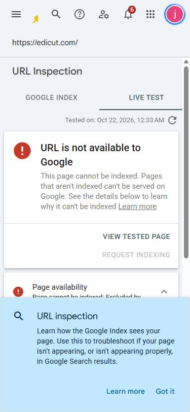
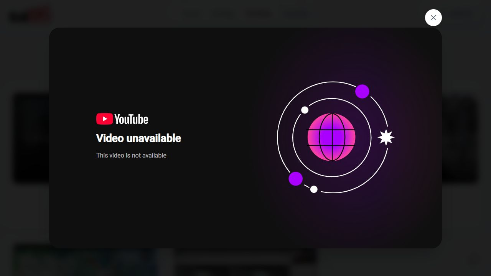

# EdiCut SEO audit — 22 October 2026

## Executive summary

**Fix production indexability first. All 20 URLs in the live sitemap currently contain `noindex, nofollow, noarchive`. Google Search Console’s live homepage test independently confirms: “Page cannot be indexed: Excluded by ‘noindex’ tag.”**

The underlying site has useful foundations: readable service URLs, server-rendered content, unique service metadata, correct canonical URLs, a working sitemap, and short internal link paths. The current deployment prevents those foundations from doing their job.

Recommended order:

| Order | Action | Impact | Effort estimate |
|---|---|---|---|
| P0 — immediately | Correct the production prerender environment and prevent deployment of public HTML containing `noindex` | Critical: index eligibility across all 20 public URLs | 2–4 engineering hours plus deployment validation |
| P1 — next | Repair the broken featured video and publish credible examples of EdiCut’s own editing | High for trust and purchase decisions; original evidence supports useful service content | 1–2 hours to repair; 2–5 days to prepare real examples |
| P1 — next | Restore the legacy `/about` journey with an equivalent permanent redirect | Medium: existing search exposure currently lands on a 404 | Under 1 hour plus validation |
| P2 — this week | Make the apex hostname redirect effective for static HTML | Medium: consolidate duplicate host signals | 1–2 hours |
| P2 — this week | Differentiate package descriptions and remove repeated “Video” from titles | Low–medium: clearer snippets and choices | 1–2 hours |

Estimates are planning estimates, not commitments. At the time of the initial audit, no production changes or application code fixes had been made. See the implementation follow-up at the end of this report for current status.

## Scope and evidence

- Business: done-for-you video editing and thumbnail services. Primary audience: UK and US creators. SEO goal: qualified project inquiries and editing-package purchases.
- Live site: `https://edicut.com`, with a bounded crawl of all 20 sitemap URLs and checks of redirects, missing pages, sign-in behavior, icons, and social imagery.
- Local comparison: `http://localhost:3002/`, current source, build configuration, and generated homepage HTML. The repository already contained extensive unrelated changes; they were preserved.
- Codex browser: rendered homepage and service metadata/schema, portfolio playback, responsive service geometry, Search Console performance, sitemap processing, and a live homepage inspection. No headless browser tests were used.
- Search Console: domain property `edicut.com`; its totals include subdomains. Performance was filtered to `^https?://(www\.)?edicut\.com/` to exclude the computer shop.
- Time: public crawl recorded `2026-10-21T18:29:41Z`, equivalent to 22 October in Bangladesh. Google’s live test displays 22 October 2026, 12:33 AM.

Supporting files are in this folder: `crawl.json`, `pages.csv`, `checks.json`, `link-analysis.json`, rendered DOM evidence, Search Console text captures, and screenshots. `crawl.py` and `checks.py` reproduce public HTTP evidence without authentication or mutations.

## 1. Critical technical finding: production HTML is noindex

**Priority:** P0. **Impact:** critical. **Confidence:** verified live; cause strongly supported by source and emitted data.

### Evidence

- All **20/20 sitemap URLs** return HTTP 200 with a robots meta tag containing `noindex, nofollow, noarchive`. This includes `/`, `/services`, every service page, `/pricing`, and all six package pages. See `pages.csv`.
- The rendered browser DOM retains the same directive on the homepage and YouTube editing page. This is not a text-extraction artifact.
- The public homepage’s serialized loader data contains `appUrl` set to **`http://localhost:3002`**. The current local production build’s `build/client/index.html` also contains `noindex`.
- Requests with normal browser and Googlebot user-agent strings reproduce the directive. These are diagnostic requests, not proof of verified Googlebot identity.
- Google’s actual live inspection reports crawl allowed **Yes**, page fetch **Successful**, indexing allowed **No: ‘noindex’ detected in ‘robots’ meta tag**. See `gsc-home-live-inspection.txt` and the screenshot below.
- `robots.txt` returns 200 and allows `/`. The sitemap returns 200 and Search Console reports **Success, 20 discovered pages**, last read 20 October. Neither overrides page-level `noindex`.
- Stored homepage inspection says indexed, last crawl 21 October at 2:24 AM. That is an earlier snapshot, not evidence that today’s deployment is indexable. Existing rankings may persist temporarily; this audit does not claim every URL has already disappeared.

### Likely cause and relevant code

- `apps/web/app/lib/context.server.ts:35` falls back to localhost when build-time `process.env.APP_URL` is absent or local.
- `apps/web/app/lib/seo.ts:66` requires a production origin before emitting indexable page metadata.
- `apps/web/react-router.config.ts:70` prerenders the public registry and active packages.
- `apps/web/wrangler.jsonc:110` sets the **runtime** `APP_URL` to production, but `assets.run_worker_first` is false at line 122. Static HTML can therefore be served without the runtime loader correcting the build-time data.

Together these explain the emitted localhost value and `noindex`. The exact historical deployment command/environment that introduced the regression was not inspected.

### Recommended fix

1. Explicitly supply `APP_URL=https://edicut.com` to the production build/prerender process. Keep local and preview builds non-indexable.
2. Add a production build guard that rejects missing or unexpected origins. Do not make localhost indexable to work around this.
3. Validate every generated public HTML file before deployment: production origin, no `noindex`, one correct canonical, expected H1, public content present. Fail deployment on a violation.
4. Verify production account/project/branch and intended changes, deploy the corrected artifact, and invalidate stale HTML through the normal deployment/cache process if needed.
5. Recheck live HTML and headers for all 20 sitemap URLs, then run Google live tests on the homepage and main service page. Request indexing only after the tests pass. The already successful sitemap does not need repeated submission.

**Acceptance:** all intended public pages return 200 and are index-eligible in raw HTML and rendered DOM; headers do not contradict this; homepage live inspection permits indexing. `/signin`, checkout, dashboards, staging, and real 404s remain excluded as appropriate.

Google documents that a crawlable `noindex` directive prevents indexing. It also warns against relying on JavaScript to remove an initial noindex directive. [Noindex documentation](https://developers.google.com/search/docs/crawling-indexing/block-indexing), [JavaScript SEO basics](https://developers.google.com/search/docs/crawling-indexing/javascript/javascript-seo-basics).

### Related symptom: homepage structured data

The rendered homepage has **zero JSON-LD blocks**; the service page has a validly parsed Service and BreadcrumbList graph. Source `root.tsx:246` gates homepage Organization/WebSite markup on the same production-indexability check. Restore this through the P0 fix and verify the rendered DOM afterwards. This is a secondary symptom, not a separate indexing blocker. JSON-LD presence alone does not guarantee a rich result.

## 2. Content and trust: a featured video cannot play

**Priority:** P1. **Impact:** high for buyer confidence; medium as a content-quality improvement. **Confidence:** playback failure verified for one featured item; ownership of work not independently verified.

On `/portfolio`, clicking **“Watch The Ridge video”** opens YouTube ID `ysz5S6PUM-U` and the player reports **“Video unavailable — This video is not available.”**

The portfolio introduction describes credited reference examples, while the homepage labels the same gallery **“Selected work.”** The reviewed service page explains the process but does not show an EdiCut-specific completed edit or case study. Reference inspiration is useful, but it does not demonstrate who edited a piece.

Recommended work:

- Replace or hide the unavailable item and check every featured video’s playback and thumbnail. Only this first item’s playback was tested; do not assume all are broken.
- Label reference material consistently on the homepage, cards, and player. Use actual channel/source attribution and confirm permission for any claimed client work.
- Publish 2–3 genuine examples: the brief, EdiCut’s role, supplied footage, editing choices, final deliverable, and a permissioned before/after clip or screenshot. Add measurable outcomes only when supported by records.
- Link the most relevant example directly from each service page. A consented internal demo can demonstrate editing decisions when client permission is unavailable, provided it is clearly identified as a demo.

**Acceptance:** all featured examples play, attribution is clear, and the main YouTube service page links to at least one verifiable EdiCut example. Do not invent clients, reviews, view counts, or retention improvements.

This recommendation follows Google’s emphasis on original information and demonstrated experience; it is not a claim that a particular number of case studies is a ranking factor. [People-first content guidance](https://developers.google.com/search/docs/fundamentals/creating-helpful-content).

## 3. Legacy `/about` traffic reaches a 404

**Priority:** P1. **Impact:** medium. **Confidence:** verified.

- `https://edicut.com/about` currently returns **404**.
- In the host-filtered Search Console Pages table, `/about` has **174 impressions, 0 clicks** in the displayed reporting period. Search-result retrieval also surfaced the former About page. This is historical exposure, not a promise of recoverable traffic.
- `/why-hire-us` is the current page explaining the team and service process and is the closest reviewed replacement.

**Fix:** add a 301/308 `/about` → `/why-hire-us` redirect after confirming the replacement covers the old page’s purpose. Update any remaining old internal links. Preserve intentional 404s elsewhere rather than redirecting every missing URL to the homepage.

**Acceptance:** both HTTP and HTTPS variants reach the equivalent production page without a loop; final URL is canonical, index-eligible, and 200. Ensure the redirect is effective before static asset routing. [Google canonical and redirect guidance](https://developers.google.com/search/docs/crawling-indexing/consolidate-duplicate-urls).

## 4. Host consolidation is incomplete on live static pages

**Priority:** P2. **Impact:** medium. **Confidence:** verified behavior; likely asset-routing cause.

- HTTP apex → HTTPS apex: **301**, healthy.
- HTTP www → HTTPS www: **301**.
- **HTTPS www homepage returns 200**, instead of redirecting to apex. It correctly declares `https://edicut.com/` as canonical, so this is not an uncanonicalized duplicate or a penalty claim.
- Source `workers/app.ts` already contains a www → apex 308, but static assets are configured to run before the Worker. Live asset responses are consistent with that redirect being bypassed. Source and deployed behavior may also differ.
- A service trailing slash redirects with **307** to the slashless URL and has a correct canonical. Making a permanent normalization is lower priority than fixing indexability.

**Fix:** apply host consolidation at an edge layer that runs before static HTML, or adjust Worker/asset routing carefully. Preserve path and query strings; keep hashed assets efficiently cached. Prefer a permanent redirect for permanent slash normalization if the platform supports it without side effects.

**Acceptance:** representative root, service, pricing, and query URLs on www reach the apex counterpart; sitemap and internal links remain apex; authentication callbacks and assets still work. A CDN/Worker redirect must be validated on the deployed response, not only in source.

Canonical links already help consolidation, and Google treats redirects as another strong signal. [Google canonicalization methods](https://developers.google.com/search/docs/crawling-indexing/consolidate-duplicate-urls).

## 5. Package metadata is repetitive

**Priority:** P2. **Impact:** low–medium. **Confidence:** verified.

- `/pricing/creator`, `/pricing/creator-plus`, and `/pricing/creator-pro` all use the description **“For new creators who need clean, consistent edits.”** This does not explain their different price, capacity, or team allocation.
- Single-video titles repeat the word: **“Creator Video Video Editing Package | EdiCut”**, with the same pattern for Studio Video and Feature Video.
- Titles are otherwise unique across the 20 sitemap URLs. Each has one H1 and a description. The service pages have distinct, relevant titles and descriptions; broad rewriting is unnecessary.

**Fix:** update the shared package metadata template (`routes/package.tsx:24`) and saved descriptions from the pricing catalog. Describe the actual intended customer and agreed capacity. Reuse catalog data so public cards, package pages, and metadata agree.

Suggested direction, subject to final catalog verification:

| Page | Title direction | Description direction |
|---|---|---|
| Creator Video | Creator Video Editing Package — $109 | Finished-length/footage allowance, revision allowance, and scope |
| Basic monthly | Basic Monthly Video Editing Package | Actual editing-hour allocation and team arrangement |
| Pro monthly | Pro Monthly Video Editing Package | Actual shared team capacity and the reason to choose this tier |

Do not change URLs just to match renamed package labels. Do not promise prices, results, or inclusions that the catalog does not support. These are snippet and clarity improvements, not duplicate-description penalties or guaranteed CTR gains.

**Acceptance:** no duplicated word in titles; distinct descriptions for the three monthly tiers; metadata agrees with visible current pricing. Judge the later result from page/query impressions and clicks rather than a fixed character limit.

## 6. Search visibility and measurement

### Observed baseline

Search Console was set to **28 days**, but the displayed chart labels cover **30 September–19 October 2026**. Treat this as the available report at audit time, not a complete fresh 28-day cohort. The filtered report also warns that totals/table results may be partial.

- Host-filtered performance shows **2 clicks**, **839 impressions**, **0.2% CTR**, **4.3 average position**. Page-filter aggregation differs from the unfiltered domain report; do not compare those totals directly as growth.
- The visible query table is dominated by **“edicut” — 2 clicks, 786 impressions**. It offers no useful demonstrated set of non-brand queries at positions 8–20 to optimize yet. Query tables may omit anonymized queries.
- Indexed-page totals of **523 indexed / 55 not indexed** are from the domain property, updated 12 October. Indexed examples shown were `computer.edicut.com/product/...`; these totals must not be presented as editing-site coverage.
- Historic impressions for sign-in and HTTP pages are present. Current sign-in is correctly noindex and HTTP redirects; monitor recrawling after the P0 fix instead of treating historic rows as proof that those fixes are absent.

### Recommended measurement after recovery

1. Use a dedicated HTTPS URL-prefix view or keep the host regex filter. Track apex/www separately when diagnosing canonicalization.
2. Confirm index eligibility for all sitemap URLs, then track actual indexing of the homepage, service hub, five service pages, pricing, and packages.
3. Track branded versus non-branded queries, UK and US countries, and mobile/desktop separately.
4. Connect organic landing pages to real inquiries and completed purchases using the existing consent and privacy model. This audit did not verify a complete attribution funnel.
5. After sufficient post-fix impressions accumulate, review page/query pairs at positions 8–20 and low CTR with meaningful impressions. Prioritize `/services/youtube-video-editing`, then formats supported by real demand and work examples.

Authority/backlink quality was not fully audited. A few referring URLs in homepage inspection do not establish a backlink profile or justify a disavow file. Earn relevant links through real creator collaborations and permissioned case studies once the main pages are indexable; do not buy links or create bulk doorway pages.

## Checks that passed, and limitations

| Area | Result |
|---|---|
| Sitemap delivery | 200, valid parsed XML, 20 unique apex URLs; Search Console Success with 20 discovered |
| Crawl access | Production robots.txt allows `/` and references the correct sitemap |
| Public HTTP status | All 20 sitemap URLs return 200 |
| Canonical tags | One correct self-canonical per sitemap URL; tested tracking query canonicalizes to the clean service URL |
| Content discovery | All 20 sitemap URLs reachable within two link steps from homepage in server HTML; no sitemap-page orphans found |
| Metadata basics | Unique titles; descriptions present; one H1 per sitemap page; `lang=en` and viewport configured |
| Schema | Browser confirmed Service + BreadcrumbList on the YouTube page; homepage graph absent as described above; no Rich Results eligibility guarantee |
| Missing pages | Tested ordinary/service/package nonexistent URLs return real 404s, avoiding soft-404 200 responses |
| 404 metadata hygiene | Unknown pricing page still says `index, follow` despite HTTP 404. Low priority: make error metadata/header exclusion explicit; a genuine 404 already prevents normal indexing |
| Account routes | Dashboard redirects to sign-in. Sign-in has noindex meta and header. No authenticated customer data was accessed |
| HTTPS | HTTP → HTTPS redirects work; HTTPS response includes HSTS |
| Favicon | ICO, SVG, PNG return 200. ICO includes 16/32/48/256 square sizes; PNG is 512×512. The actual rendered ICO URL with `?v=ec4` returns 200 for browser and Googlebot-Image user-agent checks |
| Social image | 200, PNG 1200×630 |
| Responsive sample | Live YouTube service DOM measured at 320, 375, 768 px; no horizontal overflow; primary links have 44–52 px height. This was a targeted geometry check, not a full mobile accessibility audit |
| Performance | Search Console has no Core Web Vitals data. PageSpeed API returned 429 quota exceeded. LCP/INP/CLS and a lab score remain unverified; no performance pass/fail is claimed |
| Runtime smoke check | Reviewed live tab console reported no errors/warnings. Portfolio media failure remains as above |

The favicon currently meets the checked delivery/size requirements. Google’s search icon may lag recrawling and its appearance is not guaranteed. Correct the homepage noindex first; avoid repeatedly renaming icon URLs. [Google favicon requirements](https://developers.google.com/search/docs/appearance/favicon-in-search).

The locally redesigned `#editing-services` section exists on localhost and in source but **is not deployed**: production still has the old service link strip. The live links are already crawlable. Ship the reviewed design through the corrected production build, retaining all five anchors; moving them below the portfolio is not itself an SEO problem.

No separate US/UK duplicate pages or hreflang are needed solely because one English service targets both markets. Regional pages should be added only for genuinely different offerings or useful localized content.

## Delivery plan and verification checklist

### Immediately

- [ ] Fix build-time production origin and add an artifact validation gate.
- [ ] Rebuild/redeploy the intended release; verify all 20 public URLs in HTML, headers, and rendered DOM.
- [ ] Google live tests permit indexing; Organization/WebSite data reappears on homepage.
- [ ] Keep local/staging and account pages excluded.

### This week

- [ ] Repair the first featured video and check the rest.
- [ ] Permanently map `/about` to the equivalent current page.
- [ ] Consolidate www before static serving; validate deployed results.
- [ ] Correct package titles/descriptions and publish the reviewed service-section design.
- [ ] Obtain a mobile performance report when quota permits; use real measurements to select performance work. Target good field LCP ≤2.5s, INP ≤200ms, CLS ≤0.1 at the 75th percentile; a lab run cannot prove field compliance. [Web Vitals guidance](https://web.dev/articles/vitals).

### Following weeks

- [ ] Publish verifiable work examples and integrate them into the main service pages.
- [ ] Review post-fix indexing, non-brand impressions, UK/US query demand, and qualified leads.
- [ ] Expand only into service/content topics with evidence of customer need. Add a useful preparation guide or editing comparison when it answers real questions, rather than mass-producing keyword pages.

## Files changed and commands run

The initial audit added only artifacts under `artifacts/seo-audit-2026-10-22/`. No production settings, database data, indexing requests, or sitemap submissions were changed during the audit.

Commands/checks completed:

- `python artifacts/seo-audit-2026-10-22/crawl.py` — public crawl completed.
- `python artifacts/seo-audit-2026-10-22/checks.py` — redirect, icon dimension, and CSV checks completed successfully after correcting an artifact filename.
- Repository `rg` and read-only configuration/source inspection.
- Rendered DOM/schema checks and manual playback in the Codex browser.
- Read-only Search Console inspection and live test; no indexing submission.
- PageSpeed request — blocked by external API quota (429), saved as `pagespeed-error.txt`.

Application typecheck/build/test suites were not rerun for the initial audit because no implementation changed at that time. Current generated HTML was inspected as evidence. The implementation and current release status are recorded below.

## Implementation follow-up — 22 October 2026

The following audit fixes are now implemented in the local source and build configuration:

- The Cloudflare production build sets the canonical production origin before prerendering. A build gate checks all 20 public HTML pages for indexable robots metadata, production canonicals, titles, descriptions, and H1s; it also checks required routes, homepage Organization/WebSite JSON-LD, unique monthly package descriptions, and absence of local origins.
- The Worker applies canonical host and legacy `/about` redirects before static HTML is served. `/about` redirects to `/why-hire-us` with query parameters preserved.
- Unavailable or mismatched YouTube portfolio records are filtered from public output without deleting admin records. Clearly labeled, verified channel references keep the gallery available when no saved portfolio videos pass validation. The card thumbnail handler falls back from YouTube max-resolution to high-quality thumbnails.
- Package descriptions now use the package's editor staffing feature, rather than a fixed slug, to distinguish the monthly options.
- Error-route root metadata stays `noindex`.

Local verification completed:

- `pnpm --filter @edicut/web typecheck` — passed.
- Focused SEO, routing, portfolio, root metadata, and payment-secret-isolation tests — 6 files, 44 tests passed.
- `pnpm --filter @edicut/web build:cloudflare` — passed; prerender SEO validation passed for all 20 public pages.
- `pnpm --filter @edicut/web exec wrangler deploy --dry-run --profile edicut-production` — passed; no deployment was made.
- `git diff --check` — passed; Git reported only line-ending conversion warnings.

Production deployment and verification completed on 22 October 2026:

- The user explicitly authorized deploying the current workspace. Cloudflare Worker `edicut-web` was deployed to the configured production account and routes `edicut.com/*` and `www.edicut.com/*`. Deployed version: `28225120-28ef-4e94-b5c4-6fc6d272bc7a`. The release included the then-current workspace changes, including changes outside the SEO audit scope.
- The production Cloudflare build passed the 20-page prerender SEO gate before upload.
- All 20 prerendered public routes were fetched from production and returned HTTP 200 with exactly one `robots: index, follow` meta tag, a canonical URL matching the production route, and no `X-Robots-Tag: noindex` response header.
- Production redirect checks passed: `www.edicut.com/` redirects to the apex host, and `/about` redirects to `/why-hire-us` while preserving its query string.
- Search Console's live URL test now reports “URL is available to Google” and “Page can be indexed”; the prior `noindex` diagnosis is resolved. An indexing request was submitted and Search Console confirmed the homepage was added to its priority crawl queue. “Discovery: Not checked in live tests” is informational and not an indexing issue.
- PageSpeed API remained unavailable due to quota. EdiCut-owned portfolio case studies still require real, permissioned examples; the current gallery is labeled as reference material.
