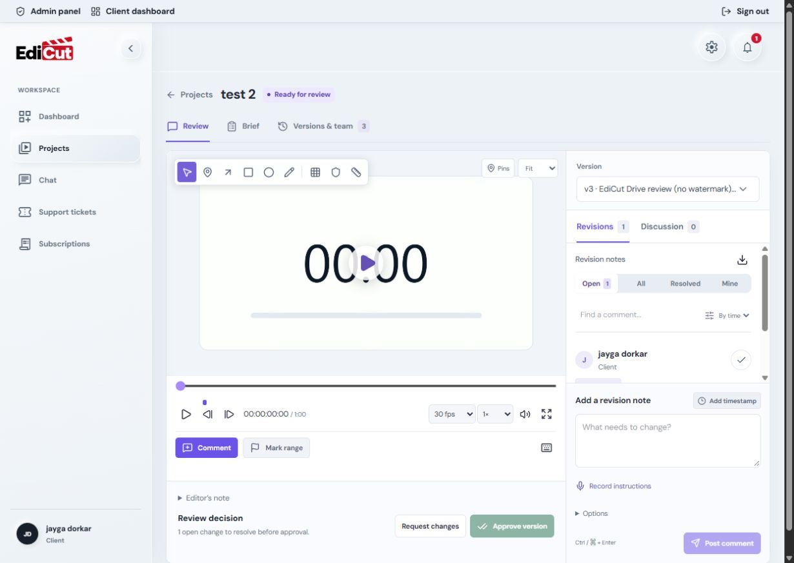
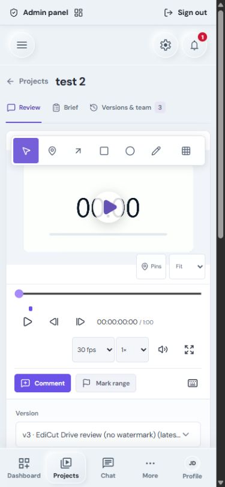

# Video proofing workspace — 15 October 2026

The review page now uses a white player beside a polished feedback sidebar. The version selector lives at the top of that sidebar, followed by separate Revisions and Discussion tabs. Typography, spacing, focus states, and mobile touch targets were adjusted. The layout takes inspiration from [Frame.io's review player](https://frame.io/v4) while retaining EdiCut's visual language and existing project workflow.

## Implemented behavior

- Timestamped on-video comments, pins, arrows, rectangles, ellipses, and freehand drawing. The on-video composer shares its draft with the sidebar; saved markers seek and focus their comment.
- Previous/next frame controls, frame timecode, configurable source frame rate, playback speed, zoom, composition grid, safe areas, and a measurement ruler. Measurements use source pixels when dimensions are available.
- Separate revision and discussion threads, with existing replies, search, sorting, resolution, CSV export, version history, and approval flows retained.
- Explicit microphone recording, preview, removal, and private voice attachments (up to two minutes and 2 MB). Failed submissions retain the draft. Microphone tracks, timers, and preview URLs are cleaned up.
- Validated normalized annotations and backward-compatible storage in the existing annotation JSONB field. Voice files use the existing private Google Drive integration and authorized media proxy; private Drive identifiers and file hashes are excluded from client data.
- HTML responses allow same-origin microphone requests with browser consent. This also supports entering the review page through client-side navigation. Embedded origins receive no microphone delegation.

No dependency or database migration was added for this change. Unrelated working-tree changes were preserved. No production data was changed and no deployment was performed.

## Changed source files

Paths below are relative to `E:/development/Edicut` and cover this proofing task only.

- `apps/web/app/components/ProjectReviewPage.tsx` — proofing stylesheet import; existing changes preserved.
- `apps/web/app/components/ProjectReviewWorkspace.tsx` — shared drafts, sidebar version selector, player/feedback integration, and draft-aware decisions.
- `apps/web/app/components/ReviewPlayer.tsx` — annotation integration and frame controls.
- `apps/web/app/components/ReviewCanvas.tsx` — new drawing, pin, grid, zoom, measurement, and on-video composer interface.
- `apps/web/app/components/ReviewFeedback.tsx` — sidebar layout, accessible tabs, comment selection, and voice submission.
- `apps/web/app/components/ReviewVoiceRecorder.tsx` — new recorder and draft preview.
- `apps/web/app/styles/review-proofing.css` — scoped white-player design, sidebar typography, and responsive layout.
- `apps/web/app/lib/review-annotations.ts` — new bounded annotation parsing, compatibility, and frame helpers.
- `apps/web/app/lib/project-review.ts` — public voice types and backward-compatible metadata serialization.
- `apps/web/app/lib/project-review.server.ts` — trusted voice metadata persistence and safe public data mapping.
- `apps/web/app/lib/review-voice.server.ts` — new file validation, private upload, retry handling, cleanup, and authorized streaming.
- `apps/web/app/lib/project-review-route.server.ts` — authenticated voice upload and media routes with existing CSRF and rate limits.
- `apps/web/workers/security-headers.ts` — document microphone policy for the recording feature.
- New or extended tests: `ProjectReviewWorkspace.test.tsx`, `review-annotations.test.ts`, `review-voice.server.test.ts`, `project-review-route.server.test.ts`, `project-review.integration.test.ts`, and `workers/security-headers.test.ts`.

## Verification

| Check | Result |
| --- | --- |
| `pnpm exec vitest run` | 109 test files passed; 1,045 tests passed. The 20 environment-dependent tests were skipped here and passed separately below. |
| `REVIEW_TEST_DATABASE_URL=<disposable localhost database> pnpm exec vitest run apps/web/app/lib/project-review.integration.test.ts apps/web/app/lib/notifications.integration.test.ts --maxWorkers=1 --no-file-parallelism` | All 20 integration tests passed against a dedicated local Postgres 17 container. Container removed after verification. |
| `pnpm --filter @edicut/web typecheck` | Passed. |
| `pnpm --filter @edicut/web build` | Passed. |
| `pnpm --filter @edicut/web exec wrangler deploy --dry-run --outdir .codex-tmp/proofing-worker` | Passed; no upload or deployment. |
| `git diff --check` | Passed. |
| ESLint | Existing configuration skips these TypeScript files; it provides no substantive lint coverage for this change. |

Browser checks covered desktop and 390-pixel mobile layouts, white controls, sidebar placement, shared comment drafts, annotation drawing and clearing, saved annotations, repeated marker selection, grid/safe areas, source-pixel measurement, and frame stepping. No horizontal overflow was observed. Native MediaRecorder was exercised with a generated test tone without using the user's microphone. A voice submission was intercepted before reaching the server to verify failure recovery and draft retention; no live comment was posted.

## Remaining limits and follow-up

- Perform an authorized voice upload/playback smoke test after deployment with the connected Google Drive account. Storage calls were mocked in unit tests; persistence and metadata isolation were verified against the disposable database.
- Match the source frame rate using the selector. YouTube embeds expose approximate frame stepping; native video seeking is used for direct media.
- A storage upload followed by an ambiguous database interruption can leave an orphan private file. Confirmed failures are cleaned up; ambiguous saves retain the file to avoid deleting an attachment that may have committed.
- Recording requires HTTPS or localhost, a supported MediaRecorder browser, and microphone consent.

## Screenshots

